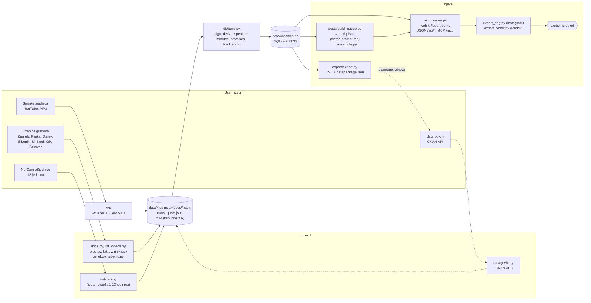

# Vijećnica: tehnička arhitektura

Dokument opisuje stanje koda 9. 11. 2026. Sve brojke dobivene su upitima nad `data/vijecnica.db` i `data/posts/posts.json` (upiti su u odjeljku [Provjera brojki](#provjera-brojki)). Ono što još nije izrađeno označeno je kao **u izradi** ili **planirano**.

## 1. Pregled

Vijećnica je cjevovod u četiri sloja:

1. **Prikupljanje** službenih podataka o sjednicama predstavničkih tijela lokalne samouprave (20 jedinica, saziv 2025.–2029.).
2. **Obrada:** parsiranje zapisnika i glasovanja, prepoznavanje govora sa snimki, povezivanje svega s točkama dnevnog reda.
3. **Pohrana** u jednu SQLite bazu s pretraživanjem punog teksta (FTS5).
4. **Objava:** web stranica, JSON API, MCP poslužitelj za AI agente, otvoreni podaci (CSV + Frictionless Data Package za CKAN) i objave za društvene mreže (Instagram PNG, Reddit Markdown).

Sav kod je Python 3.12 i otvorenog je koda (EUPL-1.2). Skupljači koriste samo standardnu biblioteku Pythona i alate `pdftotext`/`pdftoppm` (Poppler) i `tesseract`. Poslužitelj koristi `mcp`, `starlette`, `uvicorn` i `pydantic` (`requirements.txt`).

## 2. Komponente



| komponenta | datoteke | uloga |
|---|---|---|
| skupljači | `collect/docs.py`, `list_videos.py`, `brod.py`, `krk.py`, `rijeka.py`, `osijek.py`, `sibenik.py` | po jedan za šest gradova s vlastitim web stranicama |
| skupljač eSjednica | `collect/netcom.py` | jedan skupljač za 13 jedinica na sustavu NetCom eSjednice; nova jedinica = jedan redak u `UNITS` |
| ponovno parsiranje | `collect/reparse_votes.py` | Zagreb: poimenično glasovanje iz keširanih PDF-ova, bez mreže |
| konektor data.gov.hr | `collect/datagovhr.py` | izrađen: 7 skupova preko CKAN API-ja, 12 tablica i pogled `city_overview` |
| prepoznavanje govora | `asr/transcribe_local.py` (CPU), `asr/transcribe_mlx_local.py`, `asr/run_queue.py` + `asr/transcribe.py` (Apple silicon), `asr/convert_hf.py` | Silero VAD reže govor u odsječke do 25 s, Whisper ih prepisuje; vrijeme dolazi iz VAD-a |
| izgradnja baze | `db/build.py` i moduli `align.py`, `derive.py`, `speakers.py`, `minutes.py`, `promises.py`, `brod_audio.py` | uvoz JSON-a, smještanje točaka u snimku, govornici iz poziva predsjedatelja, zapisnik po točkama (Zagreb), obećanja iz aktualnog sata, rezultati izgovoreni u snimci (Slavonski Brod) |
| poslužitelj | `mcp_server.py`, `web/index.html`, `web/feed.html`, `web/demo.html` | MCP (stdio ili streamable HTTP), JSON API i web stranice u jednom procesu, samo čitanje baze |
| objave | `posts/build_queue.py`, `posts/writer_prompt.md`, `posts/assemble.py`, `posts/export_png.py`, `posts/export_reddit.py` | odabir, pisanje, spajanje, izvoz |
| otvoreni podaci | `export/export.py`, `export/check_rebuild.sh` | CSV + `datapackage.json`, provjera ponovljivosti |
| evaluacija | `eval_brod.py`, `eval_minutes.py`, `clerk_time.py`, `analysis/analyze.py` | mjerenje točnosti prema službenim dokumentima |
| osvježavanje | `run_daily.sh` | cron skripta (trenutačno za Zagreb) |

## 3. Tok podataka

1. **Dohvat.** Skupljač preuzima HTML, PDF, DOCX ili JSON odgovore i sprema ih u keš (`data/<jedinica>/raw/`). Ponovno pokretanje ne preuzima ono što već postoji (`--fresh` ponovno dohvaća popise i stranice sjednica). Skupljač eSjednica šalje najviše jedan zahtjev u sekundi i na odbijanje (HTTP 402/403, provjera bota, nema CSRF tokena) preskače jedinicu, bez zaobilaženja.
2. **Tekst.** PDF ide kroz `pdftotext -layout`; skenirani zapisnici (Krk, Viškovo 1.–9. sjednica, konstituirajuća sjednica Šibenika) kroz `pdftoppm` + `tesseract -l hrv`, s kešom OCR-a; DOCX se čita izravno iz `word/document.xml`.
3. **Struktura.** Za svaku sjednicu nastaje `docs/session_NN.json`: točke dnevnog reda, materijali, odjeljci zapisnika po točkama, rečenice o glasovanju s brojkama i citatom, nazočnost, pitanja. Popis snimki ide u `recordings.json`.
4. **Govor (neobavezno).** Snimke se prepisuju u `transcripts/<id>.json` (odsječci s vremenom). `db/align.py` pronalazi gdje u snimci počinje svaka točka i kada se glasuje, `db/speakers.py` tko govori, a `db/brod_audio.py` čita rezultate koje predsjedatelj izgovori („s 12 glasova za, pet protiv i dva suzdržana”), označene kao neslužbene.
5. **Baza.** `db/build.py` gradi `data/vijecnica.db` iznova iz JSON-a (nekoliko sekundi). JSON datoteke su izvor istine; baza je izvedena.
6. **Objava podataka.** `mcp_server.py` čita bazu (samo čitanje). `export/export.py` piše CSV po jedinici i tablici i `datapackage.json`, uz `raw_manifest.json` (sha256, veličina i vrijeme dohvata svake preuzete datoteke; 1.863 zapisa) i `export_sha256.txt`.
7. **Objave za društvene mreže.**
   1. `posts/build_queue.py` bira točke po fiksnom pravilu: svaka točka s barem jednim glasom protiv ili suzdržanim, svaka odbijena točka i svaka s nepoznatim brojem glasova protiv ili suzdržanih dobiva vlastitu objavu; ostale izglasane točke iste sjednice idu u jednu objavu „Ukratko”. Uz svaku točku ide isječak zapisnika i, za Zagreb, kako su glasali klubovi prema poimeničnom glasovanju.
   2. LLM pisac prema `posts/writer_prompt.md` piše naslov, sažetak, „zašto je važno”, argumente klubova, teme i opis.
   3. `posts/assemble.py` spaja nacrte s redom čekanja (glasovi, izvor, klubovi), dodaje oznake `#Grad #tema` i oznaku „Samo bitno” (fiksno pravilo po temi) i piše `data/posts/posts.json`.
   4. `/feed` prikazuje objave kao karusele; `posts/export_png.py` iz njih renderira PNG 1080×1350 i `caption.txt`; `posts/export_reddit.py` piše Markdown po objavi i tjedne preglede po gradu.
   5. Osoba pregledava objavu i objavljuje je ručno (nema bota).

## 4. Shema pohrane

SQLite datoteka `data/vijecnica.db`. Ključ gotovo svake tablice počinje s `city` (kratki ključ jedinice, npr. `zagreb`, `opatija`) i `session` (broj sjednice u sazivu).

| tablica | ključ | sadržaj | redaka |
|---|---|---|---|
| `cities` | `id` | naziv, tijelo („Gradsko vijeće Grada Opatije”), web stranica | 19 |
| `sessions` | `city, n` | datum (ISO 8601), naziv, poveznica, poveznica na zapisnik, tekst zapisnika | 198 |
| `items` | `city, session, no, sub` | točka dnevnog reda: naslov, predlagatelj, status, `za`/`protiv`/`suzdrzano`, `result`, `totals_note`, materijali, mjesto u snimci (`video_id`, `t_start`, `t_vote`) | 3.441 |
| `votes` | `city, session, item_no, sub, member` | poimenični glas: `za`, `protiv`, `suzdrzan`, `odsutan`, `nije_glasovao`; `source` | 26.498 (Zagreb) |
| `members` | `city, name` | član i stranka | 257 |
| `attendance` | `city, session, member` | nazočnost | 1.990 |
| `questions` | `id` | pitanje vijećnika, kome, odgovor, fonogram | 343 |
| `minutes_items` | `city, session, no, sub` | zapisnik po točki: izvjestitelj, govornici, glasovi, odluka (Zagreb) | 570 |
| `videos` | `id` | snimka: sjednica, dio, trajanje, je li transkribirana | 110 |
| `segments` | `id` | odsječak transkripta s vremenom (s) | 6.431 |
| `speaker_turns` | `id` | tko govori od–do, vrsta istupa, metoda i pouzdanost | 258 |
| `spoken_votes` | `city, session, item_no, sub, n` | rezultat izgovoren u snimci, neslužbeno (Slavonski Brod) | 182 |
| `promises` | `id` | obećanja izvršne vlasti u aktualnom satu, s rokom | 57 |
| `items_fts`, `segments_fts`, `questions_fts` | | FTS5 indeksi, `unicode61 remove_diacritics 2` (pretraga radi i bez dijakritika) | |

Objave su u `data/posts/posts.json` (JSON lista): `id`, `kind` (`item` ili `digest`), `city`, `session`, `no`, `sub`, `date`, `za`/`protiv`/`suzdrzano`, `result`, `source`, `clubs`, `headline`, `summary`, `why_it_matters`, `debate[]`, `topics[]`, `hashtags[]`, `caption`, `relevant`, `relevance`, `notes`.

## 5. Sučelja

### 5.1 JSON API (HTTP GET, `mcp_server.py --http PORT`)

Odgovor je JSON; neispravan ulaz ili nepostojeći zapis vraća HTTP 404 s `{"error": …}`.

| putanja | parametri | vraća |
|---|---|---|
| `/api/cities` | | jedinice, broj sjednica, točaka i snimki, pokrivenost transkripcijom |
| `/api/sessions` | `city` | sjednice jedinice |
| `/api/session` | `city, n` | jedna sjednica: točke, nazočnost |
| `/api/item` | `city, n, no, sub` | točka: glasovi, poimenično glasovanje, mjesto u snimci |
| `/api/search` | `q, city, n, limit` | pretraga punog teksta: točke, transkripti (s vremenom u snimci) i pitanja |
| `/api/members`, `/api/member` | `city`, `name` | članovi sa statistikom glasovanja i nazočnosti; profil člana |
| `/api/question` | `id` | pitanje i odgovor s fonogramom |
| `/api/debate`, `/api/transcript`, `/api/turns` | `city, n, no, sub` / `part, start, minutes` | rasprava o točki, dio transkripta, istupi govornika |
| `/api/draft`, `/api/minutes_eval` | `city, n, no, sub` | nacrt zapisnika iz snimke (pravila, bez LLM-a) i usporedba sa službenim |
| `/api/promises`, `/api/followup` | `city, speaker, n, status` / `id` | obećanja i kasnija spominjanja iste teme (spominjanje ne znači da je obećanje ispunjeno) |
| `/api/asr_eval` | `city` | izmjerena točnost transkripta |
| `/api/ask` | `k, city` | primjeri pitanja s odgovorom |
| `/api/posts` | | `posts.json` (feed) |
| `/api/demo` | | snimljeni razgovori agenta (`demo/demo.json`) |

Web stranice: `/` (pregled sjednica, točaka, članova, pretraga, „Pitaj Vijećnicu”), `/feed` (objave s filtrima po gradu i temi i „Samo bitno”), `/demo` (kako AI agent odgovara preko MCP-a).

### 5.2 MCP (Model Context Protocol)

`mcp_server.py` bez argumenata radi preko stdio (Claude Desktop, Claude Code i drugi MCP klijenti), a s `--http PORT` preko streamable HTTP na `/mcp`. 17 alata, svi samo čitaju: `list_cities`, `list_sessions`, `get_session`, `get_item`, `search`, `get_transcript`, `item_debate`, `speaker_turns`, `draft_minutes`, `minutes_evaluation`, `promises`, `promise_followup`, `member_record`, `get_question`, `get_minutes`, `example_questions`, `transcript_quality`. Dva predloška upita: `sazetak_sjednice` i `nacrt_zapisnika`. Ulazni parametri opisani su JSON Schemom (pydantic), a upute poslužitelja traže od agenta da navodi izvor (sjednicu, točku, trenutak snimke).

`demo/record.py` snima šest pitanja na hrvatskom na koja agent odgovara isključivo preko `/mcp`.

### 5.3 Otvoreni podaci: Frictionless Data Package za CKAN

`export/export.py` piše `data/export/<jedinica>/<tablica>.csv` i `data/export/datapackage.json`:
- CSV: UTF-8, zarez kao separator, redak zaglavlja;
- `datapackage.json`: jedan resurs po tablici i jedinici, sa shemom stupaca (`schema.fields`, tipovi `integer`, `number`, `string`), brojem redaka, veličinom, izvorom s uzorcima URL-ova i **licencom po resursu**;
- `raw_manifest.json`: sha256, veličina i vrijeme dohvata svake preuzete datoteke;
- `export_sha256.txt`: hashevi izvoza; `export/check_rebuild.sh` gradi bazu i izvoz iznova bez mreže i uspoređuje hashe.

Paket se može uvesti u CKAN (data.gov.hr) proširenjem `ckanext-datapackager` ili preko CKAN Action API-ja (`package_create`, `resource_create`). Ništa nije učitano na portal.

### 5.4 Objave: Instagram i Reddit

- `posts/export_png.py` renderira živu stranicu `/feed` (Playwright, Chromium) u `data/posts/png/<id>/1.png …` (1080×1350, omjer 4:5) i `caption.txt` s opisom i oznakama. Trenutačno: 3.435 slika za 1.014 objava.
- `posts/export_reddit.py` piše `data/posts/reddit/<id>.md` (zaglavlje s naslovom, flairom, gradom, temama i izvorom, zatim tijelo), tjedne preglede po gradu i ISO tjednu (`weekly/<grad>-<godina>-W<tjedan>.md`, dijeli ih ispod Redditove granice od 40.000 znakova) i `README.md` s uputama. Ne spaja se na Reddit.

## 6. Standardi

| standard | gdje |
|---|---|
| **CKAN Action API** | data.gov.hr kao izvor (`package_show`, `package_search`, `organization_list`) i kao odredište izvoza |
| **Frictionless Data Package / Table Schema** | `data/export/datapackage.json` |
| **CSV (RFC 4180), UTF-8** | svi izvozni resursi |
| **JSON** | međuformat skupljača (`session_NN.json`), JSON API, `posts.json` |
| **ISO 8601** datumi (`YYYY-MM-DD`), ISO tjedni | baza, izvoz, tjedni pregledi za Reddit |
| **MCP (Model Context Protocol)**, JSON-RPC 2.0, streamable HTTP | `/mcp` |
| **JSON Schema** | opisi ulaza MCP alata |
| **SQL / SQLite FTS5** | pohrana i pretraga |
| **SPDX identifikatori licenci** | `EUPL-1.2` (kod), `CC-BY-4.0` (izvedeni podaci) |
| **sha256** | `raw_manifest.json`, `export_sha256.txt` |
| **CommonMark / Reddit Markdown**, PNG | izlaz za društvene mreže |

## 7. Integracija s postojećim javnim sustavima

| sustav | danas | kako se povezuje |
|---|---|---|
| **Portal otvorenih podataka (data.gov.hr, CKAN)** | izvor: `collect/datagovhr.py` (registar jedinica, adresar, popis 2021., registar birača, porezne stope, sastav skupštine Zagreba, skupovi naših jedinica); odredište: izvoz pripremljen, nije objavljen | Kao izvor: CKAN Action API (`package_search`, `package_show`) za skupove podataka lokalnih jedinica. Kao odredište: Data Package se objavljuje kao CKAN skup podataka (resurs po CSV-u), preko API ključa organizacije izdavatelja. |
| **NetCom eSjednice** | 13 jedinica, `collect/netcom.py` | Skupljač koristi iste javne pozive koje koristi i preglednik (`/meetingtype`, `/meeting`, `/dailyagenda`, `/dldocoriginal`). Svaka sljedeća jedinica na istom sustavu dodaje se jednim retkom u `UNITS` (domaćin i id vrste sjednice), uz provjeru njezinih zapisnika. Izvoz glasovanja u strojnom obliku od isporučitelja sustava uklonio bi parsiranje zapisnika. |
| **Web stranice gradova** | Zagreb (Lotus Notes / Domino, `.nsf`), Rijeka i Osijek (WordPress), Slavonski Brod (Joomla), Krk (Drupal), Šibenik | Po jedan skupljač; nijedan grad ne nudi API za sjednice. |
| **Službeni glasnici** | **planirano** | Za jedinice bez objavljenih zapisnika: dnevni red i donesene odluke iz službenog glasnika. |
| **DIP (Državno izborno povjerenstvo)** | **planirano** | Stranački sastav vijeća iz izbornih rezultata za svih 556 jedinica lokalne samouprave (128 gradova i 428 općina), za oznake „vlast/oporba” i pregled po klubovima. |
| **AI agenti i drugi sustavi** | MCP i JSON API | Svaki MCP klijent ili HTTP klijent može čitati iste podatke. |

## 8. Kontrola kvalitete

Brojke glasova ulaze u objavu iz baze, ne iz LLM-a. Zato je najvažnija kontrola u parsiranju, a zatim u pisanju i pregledu.

### 8.1 Parsiranje glasovanja

- **Povezivanje po naslovu, ne po broju.** Odjeljak zapisnika („TOČKA N.”, „Ad N.”) povezuje se s točkom dnevnog reda po riječima naslova (najmanje 60 % riječi naslova, `collect/brod.py: heading_item`; isto pravilo u `collect/netcom.py`). Broj je samo rezerva. Razlog: na 5. sjednici Gradskog vijeća Slavonskog Broda točka 20. (mandatno povjerenstvo) uzeta je druga, pa je u zapisniku svaki kasniji naslov bio za jedan ispred dnevnog reda i **glasovi su bili pomaknuti za jednu točku**. Pogreška je uhvaćena i ispravljena u commitu `8768956`.
- **Glasovi se ne nagađaju.** „Jednoglasno” bez broja daje `za = null`, `protiv = suzdrzano = 0` i napomenu; broj se nikad ne izvodi iz nazočnosti. Ako zapisnik navodi samo ZA, ostale vrijednosti upisuju se kao 0 uz napomenu „nisu navedeni (upisano 0)”; ostali djelomični brojevi ostaju `null` uz napomenu (`totals_note`). U objavi i Reddit tekstu nepoznata vrijednost prikazuje se kao „–”, a ne kao 0.
- **Što nije glasovanje o točki:** glasovanja o amandmanima, dnevnom redu, zapisniku, objedinjavanju rasprave i proceduralnim prijedlozima ne pripisuju se točki.
- **Glas pod nepovezanim naslovom ne prelazi na prethodnu točku.** `collect/netcom.py` za svaku sjednicu bilježi koliko je rečenica o glasovanju nađeno, koliko ih je pripisano točkama, koliko je proceduralnih i amandmana, te svaki glas pod naslovom koji ne odgovara nijednoj točki (`unattached: …`, npr. Senj, 11. sjednica). Taj zapis služi za ručni pregled svake nove jedinice.
- **Ovjereni zapisnik ima prednost** pred nacrtom na istoj stranici (Punat, 6. sjednica).
- **Šibenik, „je bio”.** Šibenski zapisnici pišu „0 je bio „PROTIV“” i „4 je bilo „SUZDRŽANIH“”. Uzorak u `collect/sibenik.py` prihvaća oba oblika. Prema pitchu (`reports/pitch_hr.md`), provjera je otkrila 26 šibenskih glasovanja kojima su nedostajali glasovi protiv, među njima dva rebalansa proračuna.

### 8.2 Neovisne provjere ekstrakcije

- **Zagreb, poimenično glasovanje prema službenom zbroju:** `collect/reparse_votes.py` uspoređuje zbroj iz tablice članova sa zbrojem u zaglavlju PDF-a i bilježi razliku (`ručno` = članovi koji su glasovali dizanjem ruke; `nepotpuno` = tablica izvora nema sve oznake).
- **Snimka prema zapisniku (Slavonski Brod, 9. sjednica, `eval_brod.py`):** svih 11 rezultata koje je predsjedatelj izgovorio s brojem glasova jednaki su zapisniku; WER transkripta 0,309 na 88 od 95 odlomaka koje zapisnik prenosi (`reports/asr_eval_brod_9.json`).
- **Nacrt zapisnika prema službenom (Zagreb, 14. sjednica, `eval_minutes.py`):** rezultat glasovanja točan do broja za sve točke u snimci, ishod 100 %, vrsta akta 21/21, preciznost govornika 100 % uz odziv 15/22 (`reports/minutes_eval_zagreb_14.md`).
- **Ponovljivost:** `export/check_rebuild.sh` gradi bazu i izvoz iznova bez mreže i uspoređuje sha256 izvoza.

### 8.3 Pravila pisca (`posts/writer_prompt.md`)

Samo činjenice iz ulaza; bez vlastitih izračuna postotaka i razlika; bez ocjena odluka; argumenti se pripisuju klubu ili stranci, s jednakim prostorom za obje strane; strana kluba (`za`/`protiv`/`nepoznato`) samo ako je izvor izričito navodi; bez imena privatnih osoba i privatnih tvrtki; optužbe se ne prenose bez odgovora druge strane; svaka objava koristi samo podatke svoje točke; nesigurnosti idu u polje `notes` za urednika (npr. kad se isječak zapisnika ne odnosi na točku ili se o podtočkama glasovalo odvojeno). Pisac dobiva brojke iz baze i isječak zapisnika; razliku između njih prijavljuje u `notes` (pravila 8 i 9). Prema pitchu, tako su tijekom izrade uhvaćeni pomak glasova u Slavonskom Brodu i šibenski nedostajući glasovi protiv (8.1).

### 8.4 Automatske provjere objava (`posts/assemble.py`)

- nacrt čiji `id` nije u redu čekanja odbacuje se i prijavljuje;
- redak o izvoru uvijek dolazi iz reda čekanja, ne od pisca (ispravljeno u commitu `caa7575`: za Krk 7.–8. i Rijeku 12.–13. brojke su iz gradske vijesti jer zapisnik nije objavljen, i redak to kaže);
- ako broj glasova protiv nije poznat, iz napomene se uklanja „(upisano 0)”;
- gradonačelnik kao predlagatelj nema glas u vijeću, pa se ne svrstava ni na jednu stranu;
- teme izvan zadanog popisa odbacuju se; oznake `#Grad #tema` dodaje kod;
- „Samo bitno” je fiksno pravilo po temi (nikad po predlagatelju ili ishodu): odbijeni prijedlozi uvijek, imenovanja nikad.

### 8.5 Ljudski pregled

Svaka objava prije objave prolazi ljudski pregled; objavljuje osoba, ne bot. Upute za pregled su u `data/posts/reddit/README.md`: usporediti brojeve glasova sa zapisnikom iz izvora, ne mijenjati „–” u 0, razlikovati „nije stavljeno na dnevni red” od „odbijeno”. Prema pitchu (`reports/pitch_hr.md`), jedan krivo izračunat postotak uhvaćen je upravo u ljudskom pregledu; pravilo 1 pisca zabranjuje vlastite izračune postotaka i razlika.

## 9. Preduvjeti

### 9.1 Tehnički

- Poslužitelj s Linuxom, Python 3.12, Poppler (`pdftotext`, `pdftoppm`), `tesseract` s hrvatskim jezikom, `ffmpeg`, `yt-dlp` + Node.js (za snimke s YouTubea). Podaci, keš i audio zajedno zauzimaju oko 2 GB (`.gitignore`) i mogu se ponovno izgraditi cjevovodom.
- Periodično pokretanje (cron): `run_daily.sh` postoji za Zagreb; za ostale jedinice treba dodati njihove skupljače, `db/build.py`, `export/export.py` i izradu reda čekanja za objave.
- **LLM za pisanje objava:** pisac je zasad pokretan izvan koda repozitorija, nad datotekama `queue_*.json` i uputama `posts/writer_prompt.md`; nacrti su u `data/posts/drafts_*.json`. Za automatski rad treba API ključ pružatelja LLM-a i mali pokretač koji šalje red čekanja i upute i sprema nacrte. Upute ne ovise o pružatelju.
- Prepoznavanje govora (neobavezno): CPU radi oko 0,9× stvarnog vremena na 4 dretve (`asr/transcribe_local.py`); računalo s Apple čipom ili GPU ubrzava rad.
- Renderiranje PNG-a: Playwright i Chromium (nisu u `requirements.txt`).

### 9.2 Organizacijski

- **Urednik objava:** osoba koja pregledava i objavljuje svaku objavu, odgovara na ispravke u komentarima i ispravlja objavu uz izvor.
- **Partner:** grad ili savjet mladih za pilot (jedan Instagram profil po gradu kroz tri mjeseca, uz mjerenje dosega među mladima).
- **Moderatori subreddita:** dopuštenje prije prve objave u r/croatia, r/hrvatska, r/zagreb.
- **Izdavatelj na data.gov.hr:** objava skupa podataka traži organizaciju-izdavatelja na portalu (grad ili tim uz suglasnost MPUDT-a).
- **Gradovi i isporučitelj eSjednica:** zapisnici i glasovanje u strojnom obliku skratili bi provjeru.

### 9.3 Pravni

- **Ponovna uporaba informacija:** službeni tekst (zapisnici, naslovi točaka, pitanja, fonogrami) ponovno se koristi prema Zakonu o pravu na pristup informacijama (NN 25/13, 85/15, 69/22) i uvjetima izvora, uz navođenje izvora. Za podatke koji nisu objavljeni (npr. poimenično glasovanje izvan Zagreba) put je zahtjev za pristup informacijama.
- **Licence:** kod EUPL-1.2; izvedeni podaci CC BY 4.0; službeni tekst prema uvjetima izvora. Licenca je navedena po resursu u `datapackage.json`.
- **Osobni podaci (GDPR, Zakon o provedbi Opće uredbe o zaštiti podataka):** obrađuju se imena, glasovi i izjave vijećnika i dužnosnika u obavljanju javne funkcije, iz javno objavljenih izvora. Objave ne navode privatne osobe ni privatne tvrtke (pravilo 5 pisca). Strojni transkripti mogu sadržavati ime građanina spomenutog na sjednici; takvo se ime na zahtjev uklanja (navedeno u `datapackage.json`, `personal_data`).
- **Snimke:** audio se preuzima samo za prepoznavanje govora; objavljuju se transkripti i poveznice na trenutak izvorne snimke, ne audio.
- **Oznaka AI sadržaja:** svaka objava kaže da je sažetak strojno izrađen iz službenog zapisnika i da službeni dokumenti imaju prednost (zadnji slajd u feedu), a Reddit tekst da je objavu pripremio automatski alat i pregledala osoba. To je u skladu s obvezom transparentnosti za tekst koji generira AI iz Uredbe (EU) 2024/1689 (Akt o umjetnoj inteligenciji), čl. 50.
- **Uvjeti platformi:** Reddit traži odobrenje za automatizirani pristup, pa se objavljuje ručno.

## 10. Ograničenja i daljnji razvoj

- **Poimenično glasovanje objavljuje samo Zagreb.** Ostale jedinice objavljuju samo zbroj (ili ništa), pa se „kako su glasali klubovi” može prikazati samo za Zagreb. Sljedeći korak: zahtjevi za pristup informacijama (ZPPI) za izvještaje sustava za glasovanje.
- **Sedam jedinica bez zapisnika u bazi** (Čavle, Kostrena, Baška, Novi Vinodolski, Ploče, Omišalj, Makarska): imaju dnevni red i odluke, ali ne i glasovanje, pa nemaju objava.
- **Detaljni pregled po sjednici na web stranici `/` zasad je izrađen za 4 jedinice** (Zagreb, Slavonski Brod, Krk, Rijeka). MCP alati, JSON API i izvoz otvorenih podataka (`export/export.py`) obuhvaćaju svih 20 jedinica, a feed objava svih 13 jedinica s objavama.
- **Transkripcija:** 17 od 111 snimki u bazi (svih 12 iz Slavonskog Broda, 4 od 33 iz Zagreba, zadnja iz Čakovca), uz zadnju sjednicu Velike Gorice izvan baze.
- **Relevantnost i personalizacija:** „Samo bitno” je jednostavno pravilo po temi (723 od 1.014 objava označeno je kao bitno). Planirano: praćenje vlastitog grada i tema, obavijesti, bolja procjena važnosti uz isto javno pravilo.
- **Više jedinica:** sljedeće jedinice na eSjednicama dodaju se u `UNITS`; za ostale, dvije razine: gdje postoje zapisnici, objave s glasovanjem; za ostale, dnevni red i odluke iz službenog glasnika te stranački sastav iz podataka DIP-a.
- **data.gov.hr:** objava izvoza na portalu; kanonski nazivi stranaka iz Registra političkih stranaka; rezultati izbora 2025. na portalu, kad ih DIP objavi.
- **Video isječci** iz snimki uz objave: transkripti s vremenom postoje, isječci nisu izrađeni.

## Provjera brojki

```bash
sqlite3 -readonly data/vijecnica.db "
SELECT count(*) FROM cities;                                                     -- 20
SELECT count(*) FROM sessions;                                                   -- 205
SELECT count(*) FROM sessions WHERE date > '2026-11-08';                         -- 4 (zakazane)
SELECT count(*) FROM sessions WHERE length(minutes_text) > 0;                    -- 119
SELECT count(*) FROM items;                                                      -- 3621
SELECT count(*) FROM items WHERE za IS NOT NULL OR coalesce(result,'') != '';    -- 2188
SELECT count(*) FROM votes;                                                      -- 26498 (Zagreb)
SELECT count(*), sum(transcribed) FROM videos;                                   -- 111 | 17
SELECT count(*) FROM questions;                                                  -- 343"

python3 -c "import json,collections as c; p=json.load(open('data/posts/posts.json')); \
print(len(p), len({x['city'] for x in p}), c.Counter(x['kind'] for x in p))"   # 1014 13 item 901, digest 113
find data/posts/png -name '*.png' | wc -l                                        # 3211
```
